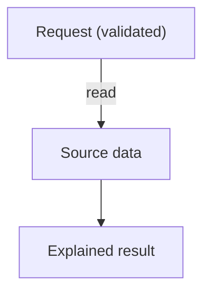

# Mermaid authoring notes

Use only when Mermaid is selected for a code explanation. Keep the owning skill's self-contained artifact and accessible fallback requirements; this reference does not make Mermaid or a network runtime mandatory.

The density budgets and layout rules in [visual-grammar.md](visual-grammar.md) apply: at most 9 nodes, `flowchart TD`, subgraphs stacked with `~~~`, at most 5 sequence participants.

- Separate simple IDs from quoted display labels. Use quoted labels for punctuation and parentheses; use one edge-label syntax per edge.
- Avoid the reserved lowercase ID `end`. Separate arrows from destination IDs, especially those beginning with `o` or `x`, which can otherwise change the edge type.
- Prefer a small connected view with short labels. Check the final width at the reader's actual viewport; shrinking a wide SVG can make otherwise valid text unreadable.
- Prefer shipping the prerendered SVG over an inlined Mermaid runtime. If you inline the runtime, confirm the console shows no Content Security Policy errors under the page's offline policy.
- Render the exact final source in its intended renderer after the last edit, then inspect clipping, label overlap, contrast, and arrow meaning. Parse success is not visual validation. Renderer/version-specific features need local evidence, not a universal compatibility promise.

Syntax basis: [Mermaid flowcharts](https://mermaid.js.org/syntax/flowchart.html). This compact reference replaces the retired standalone guidance; its missing scripts and unsupported blanket claims are not retained.
